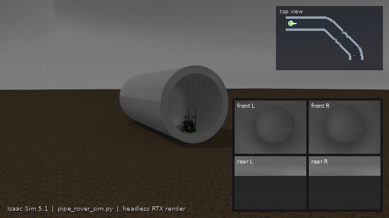

<div align="center">

# isaac-pipe-navigation

**Isaac Sim simulation of a stereo-inertial pipeline-inspection rover that paints artificial visual features on the pipe wall**

[](https://doi.org/10.1109/ACCESS.2026.3716363)
[](https://github.com/mastns/isaac-pipe-navigation/actions/workflows/ci.yml)
[](LICENSE)
[](https://docs.isaacsim.omniverse.nvidia.com)
[](https://isaac-sim.github.io/IsaacLab)
[](https://docs.ros.org/en/humble/)



<sub>Isaac Sim 5.1 renders (headless RTX, default settings, so a plain grey pipe wall), cut into three camera shots of one
scripted drive along the pipe centre line. The third-person camera and the top-view map were added for this animation and are
not part of `pipe_rover_sim.py`; the four insets are the images the simulator records (grayscale, as stored in the bag).</sub>

</div>

> ### Associated paper
> This repository contains the simulation code used in
>
> A. S. Geladaris, A. Mastrogeorgiou, O. Simatos, I. Poulakakis, M. Sfakiotakis and P. Polygerinos,
> "Artificial Feature Generation and Optimal IMU Placement for VIO in Pipeline Inspection Robots,"
> in *IEEE Access*, vol. 14, pp. 115469-115479, 2026, doi: [10.1109/ACCESS.2026.3716363](https://doi.org/10.1109/ACCESS.2026.3716363).
>
> **Keywords:** Pipelines, Visualization, Cameras, Inspection, Robots, Geometry, Image sensors, Trajectory, Spraying, Water,
> IMU fusion, localization, pipeline systems, robotics, sensor fusion, visual-inertial odometry.
>
> If you use this code, please cite the paper ([BibTeX](#citation)). This repository contains only the simulator:
> recorded data, estimators and analysis code are not included.

## What it does

A Jetbot-style differential-drive rover drives through a 3.6 m pipe with two 45 degree bends (plain grey wall; `--pipe_texture`
adds a corroded one), lying on muddy ground under an overcast sky. While it drives it

* **sees** with two stereo pairs (front and rear, 320 x 240 px, 6 cm baseline, 47 degrees field of view); two
  headlights that follow the chassis light the scene ahead,
* **senses motion** with three IMUs on a 5 cm ring (0, 120 and 240 degrees; 200 Hz, with white noise and a random-walk bias),
* **creates artificial features** by spray marking: every 0.5 s it casts 120 PhysX rays into a cone of 70 degrees half-angle
  (140 degrees wide) and leaves a small emissive orange dot wherever they hit the pipe wall,
* **records** everything to a standard ROS 2 bag: four `mono8` image streams (28.57 Hz), three IMU streams and the
  ground-truth pose (200 Hz), all in simulation time.

With the default plain grey wall the sprayed dots are the only texture on the pipe wall.

## Quick start

Requirements: Linux (tested on Ubuntu 22.04), an NVIDIA RTX GPU (tested on an RTX 3080 Ti, about 4 GB used), Python 3.11,
**Isaac Sim 5.1.0**, **Isaac Lab 2.3.2** and, to record bags, the **ROS 2 Humble Python bindings built for Python 3.11**.
Isaac Sim fetches the Jetbot model from NVIDIA's asset server, so internet access is needed. The step-by-step
[installation guide](docs/installation.md) lists the exact commands and the pitfalls.

```bash
source ~/venvs/isaac-pipe/bin/activate                # the Isaac Sim environment from the installation guide
git clone https://github.com/mastns/isaac-pipe-navigation.git && cd isaac-pipe-navigation
pip install -r requirements.txt

source /path/to/ros2_humble_py311/install/local_setup.bash   # ROS 2 bindings, only needed to record bags
python3 pipe_rover_sim.py                             # GUI + keyboard teleoperation
```

| Key | Action |
|---|---|
| Up / Down (numpad 8 / 2) | drive forward / backward (0.25 m/s) |
| Z / X (numpad 7 / 9) | turn left / right (2 rad/s) |
| `B` | start / stop recording a bag (one new folder per start) |
| `P` | spray now (automatic spraying runs every 0.5 s anyway) |
| `R` | put the rover back at its start pose (stop a running recording first: the bag keeps recording and its pose jumps) |
| `L` | zero the drive command (release the drive keys first, otherwise releasing one afterwards drives the rover backwards) |
| Esc | quit |

The Kit window needs keyboard focus. The bag is written to `rosbags/stereo_imus_<date>_<time>/`.

**No keyboard, no window:** `python3 scripts/headless_demo.py` drives the rover along the pipe, records a bag and verifies
it (topics, rates, spray dots). It is also the quickest way to check an installation. All options are documented in
[docs/configuration.md](docs/configuration.md) (`python3 pipe_rover_sim.py --help` lists them too), for example
`--seed 1` for reproducible noise and spray patterns, `--pipe_texture` for a corroded wall or `--no_hud` to hide the stereo
window. Headless runs have no keyboard, so use `scripts/headless_demo.py` for them.

## Recorded data

| Topic | Type | Rate |
|---|---|---|
| `/stereo/front/{left,right}/image_raw` | `sensor_msgs/Image` (`mono8`, 320 x 240) | 28.57 Hz |
| `/stereo/rear/{left,right}/image_raw` | `sensor_msgs/Image` (`mono8`, 320 x 240) | 28.57 Hz |
| `/imu0`, `/imu1`, `/imu2` | `sensor_msgs/Imu` (noisy, gravity included) | 200 Hz |
| `/ground_truth/pose` | `geometry_msgs/PoseStamped` (chassis in `world`) | 200 Hz |

Every bag also gets a `sim_config.json` (script and package versions, sensor parameters, all arguments). About 9 MB of
bag per simulated second. Inspect a bag with `ros2 bag info`, or with `python3 scripts/check_bag.py <bag>` (no ROS needed);
`rosbags-convert --src <bag> --dst out.bag` turns it into a ROS 1 bag.

Frames, extrinsics, camera intrinsics, the IMU noise model in continuous-time units and a few quirks that matter when you
feed the data to an estimator (for example that `rear_left` is the right-hand camera of the rear rig) are in
[docs/sensors_and_data.md](docs/sensors_and_data.md).

## Repository layout

```
pipe_rover_sim.py        the simulator: scene, sensors, main loop, command line
pipe_rover/              helpers; textures, IMU noise, spray sampling and the bag recorder run without Isaac Sim
scripts/                 headless_demo.py (scripted drive + checks), check_bag.py
assets/pipe/             pipe model (Real_sim.usd, Real_sim.stl); textures are generated on first run
tests/                   unit tests (textures, IMU noise, spray sampling, recorder, CLI defaults, scripts)
docs/                    installation, configuration, sensors and data, provenance
```

## Development

```bash
pip install -r requirements-dev.txt
ruff check .
pytest -q        # about 30 s; the two modules that need the ROS 2 Python bindings are skipped without them
```

With a ROS 2 environment sourced, run `PYTEST_DISABLE_PLUGIN_AUTOLOAD=1 pytest -q` (ROS installs register pytest plugins
that need packages of their own).

The tests do not need Isaac Sim. They pin the procedural textures to the exact images of the original script and the IMU
and spray code to its inline implementations. [docs/provenance.md](docs/provenance.md) lists how this code differs from the
original script and how that was verified on a real Isaac Sim installation.

## Citation

```bibtex
@article{geladaris2026artificial,
  author  = {Geladaris, A. S. and Mastrogeorgiou, A. and Simatos, O. and Poulakakis, I. and Sfakiotakis, M. and Polygerinos, P.},
  title   = {Artificial Feature Generation and Optimal {IMU} Placement for {VIO} in Pipeline Inspection Robots},
  journal = {IEEE Access},
  volume  = {14},
  pages   = {115469--115479},
  year    = {2026},
  doi     = {10.1109/ACCESS.2026.3716363}
}
```

GitHub's "Cite this repository" button uses [`CITATION.cff`](CITATION.cff).

## License

[MIT](LICENSE), for the code and the pipe model in `assets/pipe`. Isaac Sim and the Jetbot asset are subject to NVIDIA's
licenses and Isaac Lab to its BSD-3-Clause license; none of them is distributed here. NVIDIA, Isaac Sim, Isaac Lab and
Jetbot are trademarks of NVIDIA Corporation and ROS is a trademark of Open Robotics; this project is not affiliated with or
endorsed by them. The animation shows renders of NVIDIA's Jetbot asset.
